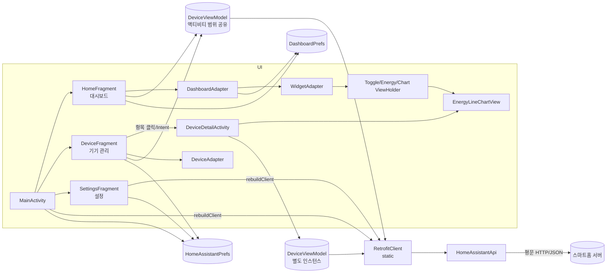
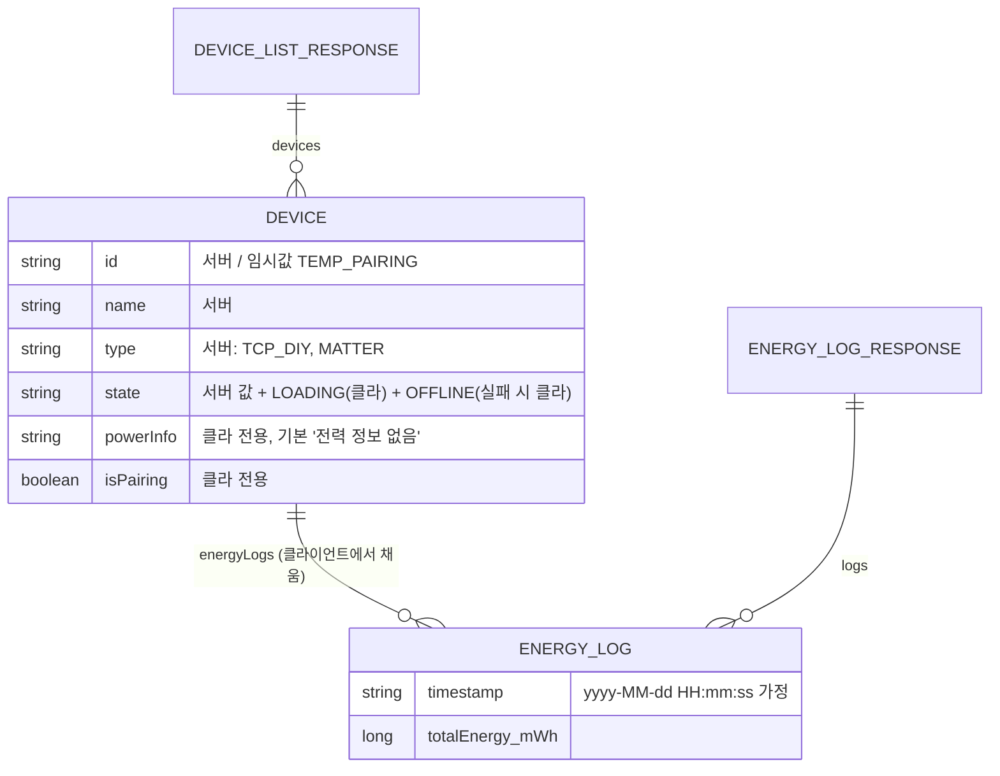
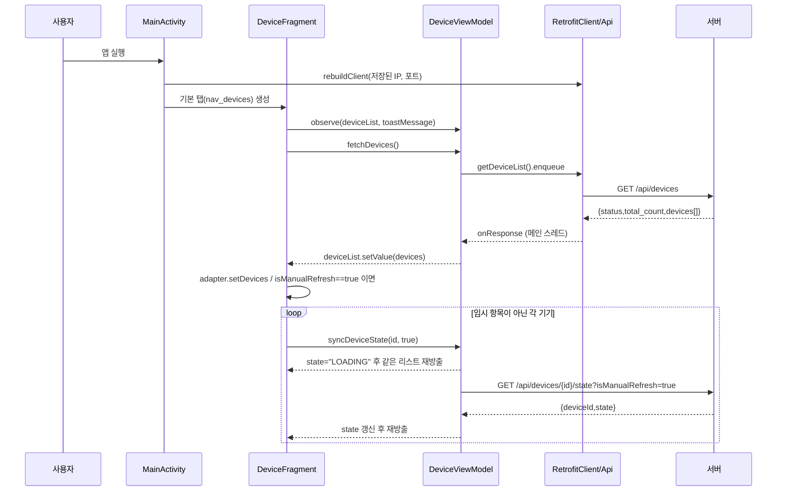
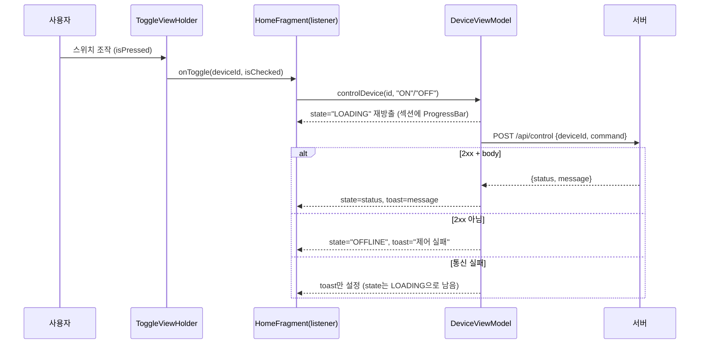
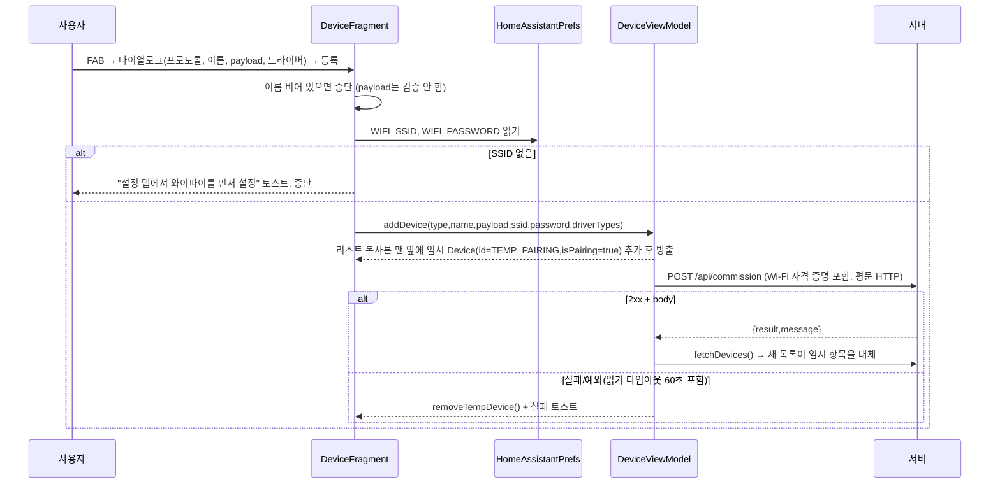

# HomeAssistantApp — 설계 (As-Is, 0단계 분석)

- 분석일: 2026-11-16 / 분석 기준 커밋: `0ca5dbf` (main)
- 원본 경로(복사하지 않음): `C:\Users\eodbs\Desktop\Agent\projects\HomeAssistantApp` (저장소 `kdy06187/HomeAssistantApp`)
- 분석 방법: 소스 전체 정독(Java 26개 파일 1,883줄, 레이아웃 XML 12개), `./gradlew lint` 실행(0 errors, 77 warnings). 기기/에뮬레이터 실행과 서버 연동은 하지 않았다.
- 표기: 근거는 `파일:줄`. 경로 접두사 `app/src/main/java/com/example/homeassistantapp/`는 생략한다(예: `viewmodel/DeviceViewModel.java:38`). 코드로 확인하지 못한 내용은 **추정**으로 표시한다.

## 1. 전체 구조

자체 호스팅 스마트홈 서버(`kdy06187/HomeAssistantServer`, 이 저장소 밖)의 REST API만 호출하는 Android 클라이언트다. 단일 `:app` 모듈, Java + XML 레이아웃, 리포지토리 계층이 없는 단일 액티비티 MVVM이다. `MainActivity`가 하단 내비게이션으로 3개 Fragment(대시보드/기기 관리/설정)를 매번 새로 만들어 교체하고, 대시보드와 기기 관리는 액티비티 범위의 `DeviceViewModel` 하나를 공유한다. ViewModel은 정적 홀더 `RetrofitClient`에서 `HomeAssistantApi`를 꺼내 `enqueue`로 호출하고 결과를 `LiveData`(`deviceList`, `toastMessage`, `detailEnergyHistory`)로 내보낸다. 영속 저장은 SharedPreferences 2개 파일뿐이며 DB는 없다. `DeviceDetailActivity`는 별도 ViewModel 인스턴스를 만들어 전력 이력 차트만 표시한다.



## 2. 기술 스택

| 영역 | 선택 | 이유(코드에서 확인된 사실 / 추정) | 관련 ADR |
|---|---|---|---|
| 언어 | Java 11 (`app/build.gradle.kts:28-31`) | 추정: 학습/개인 프로젝트 기본 템플릿 | 없음 |
| 빌드 | Gradle 8.11.1 래퍼, AGP 8.10.1 (`gradle/wrapper/gradle-wrapper.properties:4`, `gradle/libs.versions.toml:2`) | - | 없음 |
| SDK | compileSdk 36 / targetSdk 35 / minSdk 26 (`app/build.gradle.kts:7-12`) | - | 없음 |
| UI | AppCompat 1.7.1, Material 1.13.0, ConstraintLayout 2.2.1, RecyclerView(전이 의존), SwipeRefreshLayout 1.2.0 | XML 레이아웃 + findViewById (ViewBinding 미사용) | 없음 |
| 상태 관리 | AndroidX ViewModel + LiveData (activity 1.13.0 전이) | `viewmodel/DeviceViewModel.java:29-37` | 없음 |
| 네트워크 | Retrofit 2.9.0 + converter-gson 2.9.0, OkHttp(전이) (`app/build.gradle.kts:44-45`) | 타임아웃 60초 3종 (`network/RetrofitClient.java:23-27`) | 없음 |
| 차트 | MPAndroidChart v3.1.0, JitPack (`app/build.gradle.kts:46`, `settings.gradle.kts:19`) | - | 없음 |
| 저장소 | SharedPreferences (`HomeAssistantPrefs`, `DashboardPrefs`) | DB 없음 | 없음 |
| 테스트 | JUnit 4.13.2, AndroidX JUnit 1.3.0, Espresso 3.7.0 | 템플릿 예제 2개뿐 | 없음 |

## 3. 모듈 설계

### MainActivity (`MainActivity.java`)
- **책임**: 진입점. 저장된 서버 주소로 Retrofit 초기화, 하단 내비게이션에 따라 Fragment 교체. 최초 실행 시 기본 탭은 "기기 관리"(`:52-54`).
- **공개 인터페이스**: `onCreate(Bundle)`.
- **의존**: `RetrofitClient.rebuildClient`(`:28`), `HomeAssistantPrefs`의 `SERVER_IP`/`SERVER_PORT`(`:23-25`), Fragment 3종. 탭을 누를 때마다 `new`로 새 인스턴스를 만들어 `replace`(`:36-48`).

### DeviceViewModel (`viewmodel/DeviceViewModel.java`)
- **책임**: 기기 목록 상태 보유, 모든 서버 호출, 토스트 메시지 전달.
- **공개 인터페이스**:
  - `LiveData<List<Device>> getDeviceList()`, `LiveData<String> getToastMessage()`, `LiveData<List<EnergyLog>> getDetailEnergyHistory()` (`:35-37`)
  - `fetchDevices()` (`:38`), `controlDevice(String targetId, String command)` (`:59`), `addDevice(String type, String name, String payload, String ssid, String password, List<Integer> driver)` (`:82`), `deleteDevice(String deviceId)` (`:135`), `syncDeviceState(String deviceId, boolean isManualRefresh)` (`:156`), `fetchDeviceEnergy(String deviceId)` (`:176`), `fetchDeviceEnergyHistory(String deviceId)` (`:211`), `updateDeviceOrder(List<Device>)` (`:251`)
  - 내부: `updateDevice(String, Consumer<Device>)`(`:237`) — `Device` 객체를 제자리 수정 후 **같은 리스트**를 다시 `setValue`. `removeTempDevice()`(`:121`).
- **의존**: `RetrofitClient.getApi()`, dto 전부.

### RetrofitClient / HomeAssistantApi (`network/RetrofitClient.java`, `api/HomeAssistantApi.java`)
- **책임**: Base URL `http://{ip}:{port}/`로 Retrofit 인스턴스를 만들어 정적 필드에 보관.
- **공개 인터페이스**: `static void rebuildClient(String ip, String port)`(`:18`), `static HomeAssistantApi getApi()`(`:38`, `api == null`이면 하드코딩 기본 주소로 생성).
- **의존**: OkHttp, Gson 컨버터. 인증 헤더·인터셉터 없음.

### dto (`dto/*.java`)
- **책임**: 서버 JSON 계약. 4절 표 참조. `Device`는 서버 필드(`id`,`name`,`type`,`state`) 외에 클라이언트 전용 필드(`powerInfo`, `isPairing`, `energyLogs`)를 함께 가진다(`dto/Device.java:17-19,52`).

### HomeFragment + DashboardAdapter + WidgetAdapter + widgets (`fragment/HomeFragment.java`, `view/DashboardAdapter.java`, `view/WidgetAdapter.java`, `view/widgets/*`)
- **책임**: 대시보드. 기기마다 섹션 1개(`item_device_section.xml`), 섹션 안에 위젯 RecyclerView 중첩.
- **공개 인터페이스**:
  - `DashboardAdapter.OnDeviceControlListener { onToggle(String,boolean); onRefreshDevice(String); onRefreshChart(String); onRefreshEnergy(String); }` (`view/DashboardAdapter.java:33-38`)
  - `DashboardAdapter.setDeviceList(List<Device>)`, `isAnyDeviceEditing()`, `moveItem(int,int)`, `getCurrentList()`
  - `WidgetAdapter.setWidgets(List<String>, Device, listener)`, `setEditMode(boolean)`, `removeWidget(int)`, `moveItem(int,int)`, `getWidgetTypes()`, `setTouchHelper(ItemTouchHelper)`(섹션별 드래그 도우미를 위젯 ViewHolder에 전달, `view/WidgetAdapter.java:44-46`, 호출 `view/DashboardAdapter.java:238`)
  - 각 ViewHolder: `bind(Device, listener, boolean isEditMode, ItemTouchHelper, WidgetAdapter)`
- **위젯 결정 규칙**: `Device.type`이 `MATTER` 또는 `TCP_DIY`면 `TOGGLE`, `MATTER`면 추가로 `ENERGY`, `CHART`(`view/DashboardAdapter.java:123-129`). 그 뒤 `DashboardPrefs`의 `<deviceId>_widget_order` 순서로 재정렬(`:131-149`).
- **드래그 2단계**: 섹션은 `HomeFragment`의 `ItemTouchHelper` 길게 누르기(`fragment/HomeFragment.java:70-111`, 편집 중이면 비활성 `:74-76`). 위젯은 섹션별 `ItemTouchHelper`(`view/DashboardAdapter.java:197-238`)를 편집 모드에서 ViewHolder의 `startDrag`로 시작(`view/widgets/ToggleViewHolder.java:39-46` 등).
- **의존**: `DeviceViewModel`, `DashboardPrefs`, `EnergyLineChartView`.

### DeviceFragment + DeviceAdapter (`fragment/DeviceFragment.java`, `view/DeviceAdapter.java`)
- **책임**: 기기 목록, 당겨서 새로고침, 기기 추가(커미셔닝) 다이얼로그, 길게 눌러 삭제, 항목 클릭 시 상세 화면 이동. `fetchDevices()` 호출과 `toastMessage` 관찰을 하는 유일한 화면(`fragment/DeviceFragment.java:85-94`).
- **공개 인터페이스**: `DeviceAdapter.setDevices(List<Device>)`, `setOnDeviceLongClickListener(OnDeviceLongClickListener)`.
- **의존**: `DeviceViewModel`, `HomeAssistantPrefs`(`WIFI_SSID`, `WIFI_PASSWORD`), `strings.xml` 배열 3개.

### SettingsFragment (`fragment/SettingsFragment.java`)
- **책임**: 서버 IP/포트, Wi-Fi SSID/비밀번호 입력·저장, 저장 직후 `RetrofitClient.rebuildClient`.
- **의존**: `HomeAssistantPrefs`.

### DeviceDetailActivity (`activity/DeviceDetailActivity.java`)
- **책임**: 기기 이름/프로토콜/전력 이력 차트 표시. Intent extra `EXTRA_DEVICE_ID`, `EXTRA_DEVICE_NAME`, `EXTRA_DEVICE_TYPE` 수신(`:29-31`).
- **의존**: 자체 `DeviceViewModel`(기기 목록은 비어 있음), `EnergyLineChartView`.

### EnergyLineChartView (`view/EnergyLineChartView.java`)
- **책임**: MPAndroidChart `LineChart` 상속 커스텀 뷰. `setEnergyData(List<EnergyLog>)`(`:44`) — X=인덱스, Y=`totalEnergy_mWh`, X축 라벨은 타임스탬프를 `yyyy-MM-dd HH:mm:ss`로 파싱해 `HH:mm`로 표시(`:48-49`).

## 4. 데이터 모델

### 4.1 서버 REST API 계약 (서버 저장소와 일치해야 함)

Base URL: `http://{SERVER_IP}:{SERVER_PORT}/` (`network/RetrofitClient.java:19`). 인증 없음. 본문은 JSON(Gson). 정의 위치: `api/HomeAssistantApi.java:27-41`.

필드명은 JSON 이름(`@SerializedName`) 기준이다. Java 필드명이 다른 것: `total_count`→`totalCount`, `driverTypes`→`driverType`, `activePower_mW`→`activePowerMw`, `totalEnergy_mWh`→`totalEnergyMwh`(`dto/DeviceListResponse.java:11-12`, `AddDeviceRequest.java:20-21`, `EnergyResponse.java:10-15`).

| # | 메서드·경로 | 요청 | 응답 DTO와 JSON 필드 | 호출 위치 | 클라이언트가 실제로 쓰는 필드 |
|---|---|---|---|---|---|
| 1 | `GET /api/devices` | 없음 | `DeviceListResponse`: `status`(string), `total_count`(int), `devices`(Device[]) | `DeviceViewModel:39` | `devices`만 사용. `status`, `total_count` 미사용 |
| 2 | `POST /api/control` | `ControlRequest`: `deviceId`(string), `command`(string, 앱은 `"ON"`/`"OFF"`만 전송 — `HomeFragment:48`) | `ControlResponse`: `status`(string), `message`(string) | `DeviceViewModel:63` | `message`는 토스트, `status`는 **그대로 `Device.state`에 대입**(`:68`) |
| 3 | `POST /api/commission` | `AddDeviceRequest`: `protocolType`(`"TCP_DIY"`/`"MATTER"`), `deviceName`, `payload`(IP 또는 Matter 핀코드), `ssid`, `password`, `driverTypes`(int[], 드라이버 없음이면 빈 배열) | `AddDeviceResponse`: `result`(string), `message`(string) | `DeviceViewModel:103` | `message`만 토스트. `result` 미사용(성공 판정은 HTTP 2xx) |
| 4 | `POST /api/devices/delete` | `DeleteDeviceRequest`: `deviceId` | `ControlResponse`(재사용): `status`, `message` | `DeviceViewModel:139` | 본문 필드 미사용(HTTP 2xx + 본문 non-null만 확인) |
| 5 | `GET /api/devices/{deviceId}/state?isManualRefresh={bool}` | 경로 `deviceId`, 쿼리 `isManualRefresh` | `DeviceStateResponse`: `deviceId`, `state`(주석상 `"ON"`,`"OFF"`,`"UNKNOWN"`) | `DeviceViewModel:158` | `state`만 사용. 앱은 현재 코드 경로상 항상 `true`를 보냄(`DeviceFragment:75-78`, `HomeFragment:54`) |
| 6 | `GET /api/devices/{deviceId}/energy` | 경로 `deviceId` | `EnergyResponse`: `device_status`(string), `activePower_mW`(int), `totalEnergy_mWh`(long) | `DeviceViewModel:179` | 전부 사용. `device_status`는 `Device.state`에 대입(`:194`) |
| 7 | `GET /api/devices/{id}/energy/history` | 경로 `id` | `EnergyLogResponse`: `logs`(EnergyLog[]), `device_status`(string) | `DeviceViewModel:214` | 전부 사용. `device_status`는 `Device.state`에 대입(`:222`) |

`Device`(서버 → 앱): `id`, `name`, `type`, `state` 모두 string (`dto/Device.java:8-15`).
`EnergyLog`: `timestamp`(string, 앱은 `yyyy-MM-dd HH:mm:ss` 형식 가정), `totalEnergy_mWh`(long) (`dto/EnergyLog.java:7-11`, `view/EnergyLineChartView.java:48`).

계약상 주의(서버와 대조 필요, 서버 코드는 이번에 확인하지 않음):
- 필드 이름 규칙이 섞여 있다: camelCase(`deviceId`, `protocolType`, `driverTypes`), snake_case(`total_count`, `device_status`), 혼합(`activePower_mW`, `totalEnergy_mWh`).
- 성공 표시 필드 이름이 응답마다 다르다: `status`(목록·제어·삭제) vs `result`(커미셔닝).
- `Device.state` 한 필드에 서로 다른 응답의 값(`DeviceStateResponse.state`, `ControlResponse.status`, `EnergyResponse.device_status`, `EnergyLogResponse.device_status`)과 클라이언트 전용 `LOADING`, 실패 시 `OFFLINE`이 모두 들어간다. 토글 스위치는 `state`가 대소문자 무시하고 `"ON"`일 때만 켜짐으로 표시한다(`view/widgets/ToggleViewHolder.java:51`).
- `driver_value_array` 값 `0/1/2`(없음/PC/TV)가 서버의 드라이버 타입 정수와 같아야 한다(`res/values/strings.xml:11-15`).

### 4.2 클라이언트 모델



### 4.3 SharedPreferences 키

| 파일 | 키 | 형식 | 쓰는 곳 | 읽는 곳 |
|---|---|---|---|---|
| `HomeAssistantPrefs` | `SERVER_IP` | string | `SettingsFragment:67` | `MainActivity:24`, `SettingsFragment:42` |
| `HomeAssistantPrefs` | `SERVER_PORT` | string | `SettingsFragment:68` | `MainActivity:25`, `SettingsFragment:43` |
| `HomeAssistantPrefs` | `WIFI_SSID` | string(평문) | `SettingsFragment:69` | `SettingsFragment:44`, `DeviceFragment:126` |
| `HomeAssistantPrefs` | `WIFI_PASSWORD` | string(**평문**) | `SettingsFragment:70` | `SettingsFragment:45`, `DeviceFragment:127` |
| `DashboardPrefs` | `device_order` | 기기 id를 쉼표로 연결(끝에 쉼표) | `HomeFragment:100-106` | `HomeFragment:117-118` |
| `DashboardPrefs` | `<deviceId>_widget_order` | 위젯 타입(`TOGGLE`,`ENERGY`,`CHART`)을 쉼표로 연결 | `DashboardAdapter:226-231` | `DashboardAdapter:131-132` |

Intent extra: `EXTRA_DEVICE_ID`, `EXTRA_DEVICE_NAME`, `EXTRA_DEVICE_TYPE` (`view/DeviceAdapter.java:78-80` → `activity/DeviceDetailActivity.java:29-31`).

## 5. 주요 흐름

### 5.1 앱 시작 ~ 기기 목록 표시 (Fragment → ViewModel → Retrofit)

근거: `MainActivity:23-54`, `DeviceFragment:67-94`, `DeviceViewModel:38-56,156-175,237-250`.
- 위 흐름은 **앱 첫 진입** 기준이다. 탭에 다시 들어올 때는 ViewModel에 남은 옛 목록이 먼저 방출되어 동기화가 옛 목록에만 돌고 `isManualRefresh`가 잠기므로, 뒤이어 온 새 목록은 동기화되지 않는다(문제점 P-29).

### 5.2 대시보드 토글 제어

근거: `view/widgets/ToggleViewHolder.java:51-56`, `HomeFragment:46-50`, `DeviceViewModel:59-80`.

### 5.3 커미셔닝 (TEMP_PAIRING)

근거: `DeviceFragment:98-142`, `DeviceViewModel:82-134`. 임시 항목을 건너뛰는 곳: `DeviceFragment:77`, `HomeFragment:144,166`, `DeviceAdapter:58-68`, `DashboardAdapter:89-94`.

### 5.4 대시보드 전력/차트 자동 갱신
- `HomeFragment`의 `deviceList` 옵저버: 저장된 `device_order`로 정렬 → `MATTER` 기기 중 `energyLogs == null`이고 아직 요청하지 않은 id에 대해 `fetchDeviceEnergyHistory` 1회(`HomeFragment:115-154`, 중복 방지 집합 `requestedChartIds`는 Fragment 인스턴스 필드 `:34`).
- `onResume`: 모든 `MATTER` 기기에 `fetchDeviceEnergy`, 로그가 이미 있으면 `fetchDeviceEnergyHistory`도 호출(`HomeFragment:158-178`).
- 각 호출은 `state`를 `LOADING`으로 바꾸고 응답의 `device_status`로 덮어쓴다(`DeviceViewModel:178,194,212,222`).

### 5.5 위젯 편집(순서 변경/삭제)
섹션의 편집 버튼 → `editingDeviceIds` 토글(`DashboardAdapter:71-78`) → `WidgetAdapter.setEditMode(true)` → 각 위젯에 삭제 버튼 표시, 터치 즉시 드래그 → 드래그 종료 시 `<deviceId>_widget_order` 저장(`DashboardAdapter:222-233`). 삭제는 메모리 리스트만 변경(`WidgetAdapter:49-52`). 주의: 터치 리스너는 부모 `itemView`에만 걸려 스위치·차트 위를 누르면 드래그가 아닌 원래 동작이 일어날 수 있다(문제점 P-30). 섹션 드래그 저장은 화면 갱신보다 늦게 실행되어 두 번째부터 순서가 되돌아간다(문제점 P-28).

## 6. 요구사항 대응표

요구사항 문서(`docs/01_요구사항.md`)가 없다. 코드에서 역으로 뽑은 기능 ID는 `기능목록.md`를 기준으로 한다.

| REQ-ID | 담당 모듈 | 비고 |
|---|---|---|
| F-01 기기 목록 | DeviceFragment, DeviceViewModel | 요구사항 문서 없음(역추출) |
| F-02~04 상태 동기화/제어 | HomeFragment, DashboardAdapter, DeviceViewModel | |
| F-05~06 커미셔닝/삭제 | DeviceFragment, DeviceViewModel | |
| F-07~09 전력/차트 | HomeFragment, widgets, EnergyLineChartView, DeviceDetailActivity | |
| F-10~13 대시보드 편집 | HomeFragment, DashboardAdapter, WidgetAdapter | |
| F-14~15 설정 | SettingsFragment, RetrofitClient | |

## 7. 폴더 구조

```
HomeAssistantApp/
├─ build.gradle.kts, settings.gradle.kts(JitPack), gradle.properties
├─ gradle/libs.versions.toml, gradle/wrapper/
├─ CLAUDE.md
└─ app/
   ├─ build.gradle.kts, proguard-rules.pro
   └─ src/
      ├─ main/AndroidManifest.xml
      ├─ main/java/com/example/homeassistantapp/
      │  ├─ MainActivity.java                 (57줄)
      │  ├─ activity/DeviceDetailActivity.java (53)
      │  ├─ api/HomeAssistantApi.java          (42)
      │  ├─ dto/  (11개: Device, *Request, *Response, EnergyLog)
      │  ├─ fragment/ HomeFragment(179), DeviceFragment(153), SettingsFragment(77)
      │  ├─ network/RetrofitClient.java        (45)
      │  ├─ view/ DashboardAdapter(243), DeviceAdapter(136), WidgetAdapter(118), EnergyLineChartView(87)
      │  ├─ view/widgets/ ToggleViewHolder, EnergyViewHolder, ChartViewHolder
      │  └─ viewmodel/DeviceViewModel.java     (259)
      ├─ main/res/layout/ (12개), menu/bottom_nav_menu.xml, values/strings.xml, xml/(백업 규칙 2개, 샘플 그대로)
      ├─ main/res/drawable/ (ic_edit, ic_close, ic_router, ic_settings, ic_wifi, ic_lock 등 아이콘), values/themes.xml(Theme.HomeAssistantApp)
      ├─ test/…/ExampleUnitTest.java           (템플릿)
      └─ androidTest/…/ExampleInstrumentedTest.java (템플릿)
```

빌드·실행: 저장소 루트에서 `./gradlew assembleDebug`(성공 확인됨), `./gradlew lint`(0 errors, 77 warnings, 보고서 `app/build/reports/lint-results-debug.html`). `local.properties`(SDK 경로)가 필요하며 Git에 없다.

## 8. 구현 순서

As-Is 문서이므로 해당 없음. 커밋 이력상 순서(추정, `git log` 최근 5건 기준): 대시보드 위젯 편집 → 드라이버 선택 추가 → 드라이버 타입 int 변경 → CLAUDE.md 추가. 1단계에서 고칠 항목의 우선순위는 `문제점.md`의 심각도 순서를 따른다.

## 9. 리뷰 반영

| 출처 (Gemini / 보안 / 사용자) | 지적 | 반영 여부 | 이유 |
|---|---|---|---|
| Gemini (2026-11-16) | 섹션 순서 드래그 되돌아감 | 반영 | 코드 확인. 문제점 P-28, 기능 F-11 |
| Gemini | 탭 재진입·추가·삭제 뒤 상태 동기화 누락 | 반영 | 코드 확인. P-29, F-02, 5.x 흐름 주석 |
| Gemini | 편집 모드에서 스위치·차트 터치 오작동 | 반영 | 코드 확인(재사용 조건은 추정). P-30, F-12 |
| Gemini | 첫 차트 이력 실패 시 재시도 막힘 | 반영 | 코드 확인. P-31, F-08 |
| Gemini | P-04 "대시보드에서 복구 불가"는 과장, LOADING 중 중복 요청 가능 | 반영 | 위젯은 계속 조작 가능. P-04 문구 수정 |
| Gemini | P-10 "두 화면이 다시 그려짐"은 과장 | 반영 | `replace`로 화면 하나만 살아 있음 |
| Gemini | addDevice 성공 후 목록 조회 실패 시 임시 항목 잔류 | 반영 | P-12 (7) |
| Gemini | 토글 ON 판정 대소문자 무시, DTO JSON/Java 필드명 혼동, `setTouchHelper`·drawable·themes 누락 | 반영 | 4.1 표 앞 설명, 공개 인터페이스, 폴더 구조 |
| Gemini | 파일 줄 수 1줄 차이 | 반영 안 함 | 끝 줄바꿈 계산 차이, 의미 없음 |

## 부록: 확인하지 못한 것

- 서버(`kdy06187/HomeAssistantServer`)의 실제 엔드포인트·필드·`status`/`device_status` 값 집합. 4.1 표는 앱 코드 기준이다.
- 실제 기기/에뮬레이터 실행 동작(토스트, 드래그, 회전 시 복원, 예외 발생 여부). `문제점.md`의 충돌 항목은 코드 경로 분석 결과이며 실행 재현은 하지 않았다.
- 릴리스 빌드(`assembleRelease`), 단위/계측 테스트 실행.
